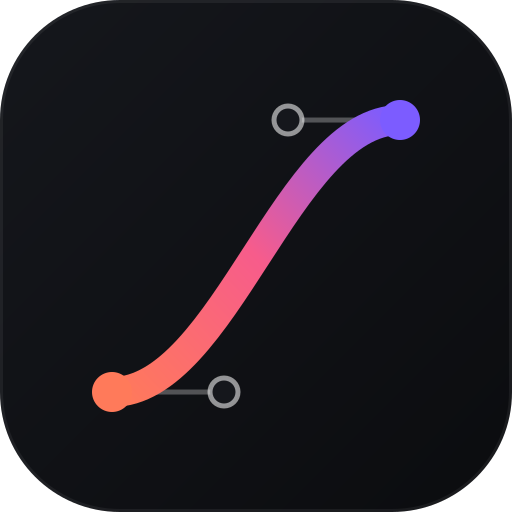

<p align="center">
  
</p>

<h1 align="center">visual-design power for Kiro</h1>

A Kiro power for frontend design and motion work. It bundles three sets of agent skills with two MCP servers:

- **Impeccable** for design, redesign, critique, audit and polish of interfaces.
- **Taste Skill** (`design-taste-frontend`) for building company websites that don't look generic.
- **Emil Kowalski's skills** for animation, gestures, UI polish and related tasks.
- **Figma MCP** (remote, `https://mcp.figma.com/mcp`) for reading design context from Figma files.
- **Playwright MCP** (`@playwright/mcp`) for opening and checking pages in a real browser.

## Install

In Kiro, open the Powers panel, choose **Add Custom Power → Import power from GitHub**, and enter:

```
https://github.com/Walsen/visual-design-power
```

Kiro turns the power on when a request mentions one of the keywords in `plugin.json`, such as design, UI, landing page, animation, Figma or Playwright.

## Getting started

The power ships two guide skills:

- **`visual-design-onboarding`** checks Node.js, the Playwright MCP package, a local Chromium and the Impeccable launcher (`scripts/check-setup.sh`). It also tests the Playwright and Figma servers and tells you what to fix. Ask Kiro to "get started with the visual-design power".
- **`visual-design-guide`** maps requests to the right skill and lists the Kiro workarounds: the Impeccable decision page, missing subagents, screenshots without Playwright, and the manual detector run.

## Requirements

- Node.js, for the Playwright MCP server and Taste Skill's scripts.
- A Figma account. Figma asks you to sign in through the browser the first time the server connects.

## Contents

```
plugin.json   manifest and activation keywords
mcp.json      Figma and Playwright MCP servers
skills/       22 skills (20 upstream + 2 guides)
assets/       logo (svg + png)
licenses/     upstream licenses
```

| Source | Skills | License |
|---|---|---|
| [pbakaus/impeccable](https://github.com/pbakaus/impeccable) (v4.8.2) | impeccable | Apache-2.0 |
| [Leonxlnx/taste-skill](https://github.com/Leonxlnx/taste-skill) (v2.5.1) | design-taste-frontend | MIT |
| This power | visual-design-onboarding, visual-design-guide | MIT |
| [emilkowalski/skill](https://github.com/emilkowalski/skill) | animate, animate-expo, animation-performance, animation-vocabulary, apple-design, ask-sonner, break-ui, choreograph, emil-design-eng, find-animation-opportunities, gestures, improve-animations, mobile-native, pick-ui-library, prototype, remove-animations, review-animations, write-swift | MIT |

## Credits

The upstream skills are the work of their authors and are copied here unchanged under their licenses. The two guide skills are original to this power and MIT-licensed. All licenses are in `licenses/`. For the latest versions, see the upstream repositories above.

## Known limitations

- Taste Skill defines a Claude Code hook in its `SKILL.md` that runs its final check (`scripts/gate.mjs`). Kiro doesn't run hooks defined inside skills, so the agent runs that check by hand when the skill asks for it.
- Impeccable and Taste Skill both cover frontend design. If their advice conflicts, name the skill you want in your request.
